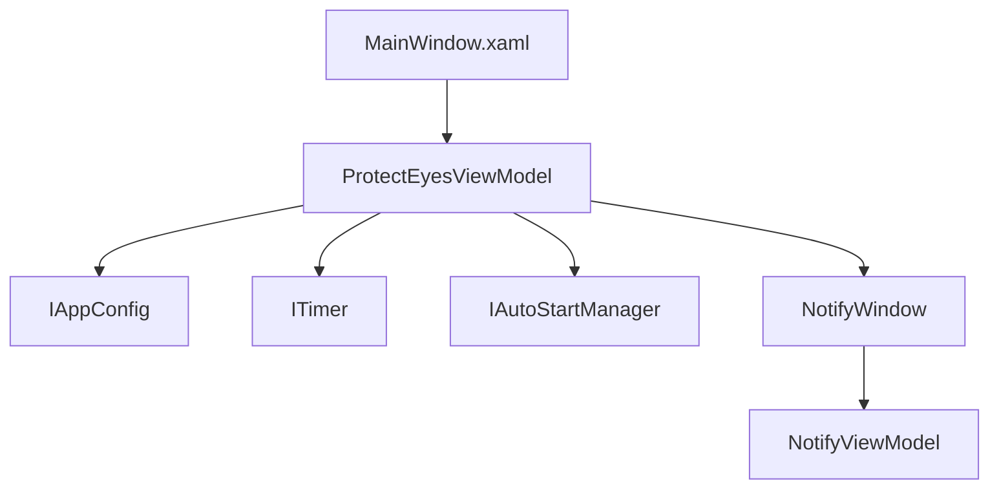
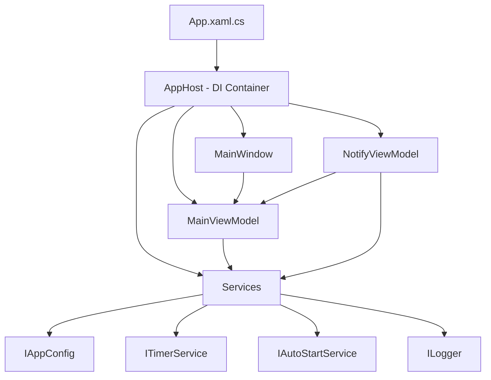

# ProtectEyes 现代化改造方案

## 项目现状分析

### 当前架构
- **技术栈**: .NET 9.0-windows, WPF
- **MVVM实现**: 自定义基础类 (`BaseViewModel`, `CommandHandler`)
- **依赖管理**: 手动实例化，无依赖注入容器
- **UI框架**: 原生WPF控件，无现代UI框架
- **配置系统**: 使用 `Microsoft.Extensions.Configuration` + JSON文件
- **日志系统**: 无

### 现有问题
1. 界面风格陈旧，使用原生WPF控件
2. ViewModel实现较为基础，缺少现代MVVM特性
3. 服务实例化手动管理，不利于测试和扩展
4. 缺少日志系统
5. 代码结构可以进一步优化

## 改造目标

### 1. 引入现代UI框架
**选择方案**: Material Design in XAML (MaterialDesignThemes)

**理由**:
- 与WPF集成良好，社区活跃
- 提供丰富的现代UI控件和样式
- 支持主题切换（浅色/深色）
- 文档完善，易于上手

### 2. 引入MVVM框架
**选择方案**: CommunityToolkit.Mvvm (Microsoft)

**理由**:
- 微软官方维护，轻量级
- 源码生成器减少样板代码
- 提供 `ObservableObject`, `RelayCommand`, `ObservableProperty` 等特性
- 与.NET生态集成良好

### 3. 完善依赖注入
**选择方案**: Microsoft.Extensions.DependencyInjection

**理由**:
- 已在使用Microsoft.Extensions，保持一致
- 轻量级，功能完善
- 支持服务生命周期管理

## 详细改造计划

### 阶段一：基础设施准备

#### 1.1 添加NuGet包
```xml
<PackageReference Include="MaterialDesignThemes" Version="5.2.0" />
<PackageReference Include="MaterialDesignColors" Version="5.0.0" />
<PackageReference Include="CommunityToolkit.Mvvm" Version="8.3.0" />
<PackageReference Include="Microsoft.Extensions.DependencyInjection" Version="9.0.0" />
<PackageReference Include="Microsoft.Extensions.Logging" Version="9.0.0" />
<PackageReference Include="Microsoft.Extensions.Logging.Console" Version="9.0.0" />
```

#### 1.2 项目结构调整
```
ProtectEyes/
├── App.xaml / App.xaml.cs           # 应用程序入口
├── Views/                            # 视图层
│   ├── MainWindow.xaml/.cs          # 主窗口
│   └── NotifyWindow.xaml/.cs        # 通知窗口
├── ViewModels/                       # 视图模型层
│   ├── MainViewModel.cs             # 主窗口ViewModel
│   └── NotifyViewModel.cs           # 通知窗口ViewModel
├── Services/                         # 服务层
│   ├── Interfaces/                  # 服务接口
│   │   ├── IAppConfig.cs
│   │   ├── ITimerService.cs
│   │   └── IAutoStartService.cs
│   └── Implementations/             # 服务实现
│       ├── JsonAppConfig.cs
│       ├── TimerService.cs
│       └── AutoStartService.cs
├── Models/                           # 模型层（如需要）
├── Infrastructure/                   # 基础设施
│   ├── AppHost.cs                    # DI容器配置
│   └── LoggingConfig.cs             # 日志配置
└── Resources/                        # 资源文件
```

### 阶段二：依赖注入实现

#### 2.1 创建AppHost类
```csharp
public class AppHost
{
    public static IServiceProvider Services { get; private set; }

    public static void ConfigureServices()
    {
        var services = new ServiceCollection();
        
        // 注册服务
        services.AddSingleton<IAppConfig, JsonAppConfig>();
        services.AddSingleton<ITimerService, TimerService>();
        services.AddSingleton<IAutoStartService, AutoStartService>();
        
        // 注册ViewModels
        services.AddTransient<MainViewModel>();
        services.AddTransient<NotifyViewModel>();
        
        // 注册Views
        services.AddSingleton<MainWindow>();
        
        // 配置日志
        services.AddLogging(builder =>
        {
            builder.AddConsole();
            builder.SetMinimumLevel(LogLevel.Information);
        });
        
        Services = services.BuildServiceProvider();
    }
}
```

#### 2.2 修改App.xaml.cs
```csharp
public partial class App : Application
{
    protected override void OnStartup(StartupEventArgs e)
    {
        base.OnStartup(e);
        
        // 配置DI
        AppHost.ConfigureServices();
        
        // 获取主窗口并显示
        var mainWindow = AppHost.Services.GetRequiredService<MainWindow>();
        mainWindow.Show();
    }
}
```

### 阶段三：MVVM框架迁移

#### 3.1 改造MainViewModel
**改造前** (基于自定义BaseViewModel):
```csharp
public class ProtectEyesViewModel : BaseViewModel
{
    int _duration;
    public int Duration
    {
        get => _duration;
        set
        {
            _duration = value;
            NotifyPropertyChange(nameof(DurationDesc));
        }
    }
    public ICommand SaveConfigCommand { get; set; }
}
```

**改造后** (基于CommunityToolkit.Mvvm):
```csharp
public partial class MainViewModel : ObservableObject
{
    [ObservableProperty]
    private int _duration;
    
    [ObservableProperty]
    private string _durationDesc;
    
    partial void OnDurationChanged(int value)
    {
        DurationDesc = $"Duration: {value} minutes";
    }
    
    [RelayCommand]
    private void SaveConfig()
    {
        // 实现保存逻辑
    }
}
```

#### 3.2 改造NotifyViewModel
类似地，使用 `[ObservableObject]`, `[ObservableProperty]`, `[RelayCommand]` 特性。

### 阶段四：UI现代化改造

#### 4.1 MainWindow界面改造
**改造前**: 使用原生TabControl、Slider、CheckBox等
**改造后**: 使用Material Design控件

```xaml
<Window x:Class="ProtectEyes.Views.MainWindow"
        xmlns="http://schemas.microsoft.com/winfx/2006/xaml/presentation"
        xmlns:x="http://schemas.microsoft.com/winfx/2006/xaml"
        xmlns:materialDesign="http://materialdesigninxaml.net/winfx/xaml/themes"
        Title="Protect Eyes" Height="450" Width="500"
        TextElement.Foreground="{DynamicResource MaterialDesignBody}"
        Background="{DynamicResource MaterialDesignPaper}">
    
    <Window.Resources>
        <ResourceDictionary>
            <ResourceDictionary.MergedDictionaries>
                <materialDesign:BundledTheme BaseTheme="Light" 
                    PrimaryColor="Teal" SecondaryColor="Lime" />
                <ResourceDictionary Source="pack://application:,,,/MaterialDesignThemes.Wpf;component/Themes/MaterialDesign3.Defaults.xaml" />
            </ResourceDictionary.MergedDictionaries>
        </ResourceDictionary>
    </Window.Resources>
    
    <materialDesign:DialogHost>
        <Grid>
            <TabControl Style="{StaticResource MaterialDesignTabControl}">
                <TabItem Header="配置">
                    <StackPanel Margin="16">
                        <materialDesign:Card Padding="16" Margin="0,0,0,16">
                            <StackPanel>
                                <TextBlock Text="{Binding DurationDesc}" 
                                           Style="{StaticResource MaterialDesignHeadline6TextBlock}"/>
                                <Slider Value="{Binding Duration}" 
                                        Maximum="600" Minimum="1"
                                        Style="{StaticResource MaterialDesignSlider}"/>
                            </StackPanel>
                        </materialDesign:Card>
                        
                        <!-- 更多Material Design控件 -->
                    </StackPanel>
                </TabItem>
            </TabControl>
        </Grid>
    </materialDesign:DialogHost>
</Window>
```

#### 4.2 NotifyWindow界面改造
使用Material Design的Card、Button、TextBlock等控件，添加现代动画效果。

### 阶段五：配置和日志系统改进

#### 5.1 配置系统增强
- 使用 `IOptions<T>` 模式（可选）
- 添加配置验证
- 支持热重载

#### 5.2 日志系统实现
```csharp
public partial class MainViewModel : ObservableObject
{
    private readonly ILogger<MainViewModel> _logger;
    
    public MainViewModel(ILogger<MainViewModel> logger, IAppConfig config)
    {
        _logger = logger;
        _logger.LogInformation("MainViewModel initialized");
    }
}
```

## 架构变化对比

### 当前架构


### 改造后架构


## 实施步骤

1. **备份当前项目** - 确保可以回滚
2. **添加NuGet包** - 引入所需框架
3. **创建新的项目结构** - 按层组织代码
4. **实现依赖注入** - 配置AppHost
5. **迁移ViewModels** - 使用CommunityToolkit.Mvvm
6. **改造Views** - 应用Material Design
7. **改进配置和日志** - 完善基础设施
8. **测试验证** - 确保功能正常
9. **优化调整** - 根据测试结果调整

## 预期效果

### 界面方面
- 现代Material Design风格
- 支持主题切换
- 更流畅的动画效果
- 响应式布局

### 架构方面
- 清晰的职责分离
- 易于测试（依赖注入）
- 易于扩展（新功能可快速添加）
- 更好的可维护性

## 风险评估

| 风险 | 影响 | 应对措施 |
|------|------|----------|
| UI框架引入导致界面变化 | 中 | 逐步迁移，保持功能不变 |
| MVVM框架学习成本 | 低 | CommunityToolkit.Mvvm简单易用 |
| DI配置复杂度 | 低 | 从简单配置开始，逐步完善 |
| 兼容性问题 | 低 | .NET 9.0兼容性好 |

## 总结

本方案通过引入现代UI框架、MVVM框架和依赖注入容器，将ProtectEyes项目进行全面现代化改造。改造后的项目将具有更好的用户体验、更清晰的架构和更好的可维护性。
